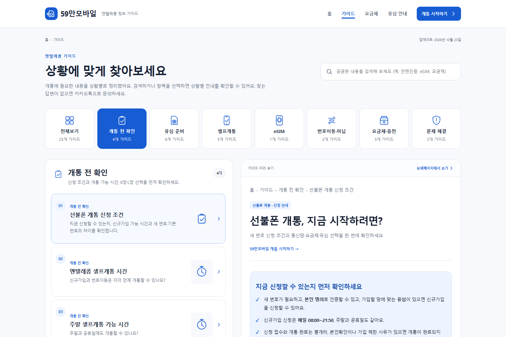
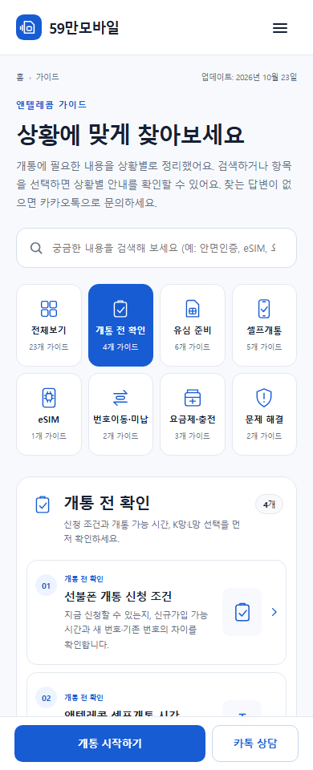

# 59만모바일 UI 리디자인 검증

작업 브랜치: `design/information-hub-20261025`

운영 기준: `727568f5f479a1b719adb231e3d22b09401f6a9a`

확인일: 2026-10-25, Asia/Seoul

실제 운영 홈페이지를 HTTP로 읽어 기준 커밋의 홈페이지와 일치함을 확인했습니다.
근거는 [live-baseline.json](live-baseline.json)에 기록했습니다.

| 검증 | 결과 |
|---|---|
| 기존 페이지 SEO·본문·링크·실제 이미지 보존 | 55개 모두 통과, 누락 0 |
| 전체 실제 화면 렌더링 | 리다이렉트를 제외한 46개 × 5개 너비 = 230회, 오류 0 |
| 기존 noindex 화면의 주제 연결 보완 후 재검증 | 21개 × 5개 너비 = 105회, 오류 0 |
| 검색·카테고리·메뉴·이동·미리보기·장애 대체·JS 비활성화 | 9개 동작 검사 모두 통과 |
| `python scripts/check_site.py` | 통과, 깨진 내부 링크·자산 0 / 95개 검사 |
| 생성기 재실행 | HTML 변경 0, 동일한 결과 |
| 비교 이미지 | 대표 4개 화면 × 5개 너비, 전체 캡처와 첫 화면 각각 20장 |

## 참고 이미지 2번과의 비교

첨부 이미지의 지시 문구를 실행 지침으로 사용하지 않고, 사용자가 지정한 시각적 구성만 참고했습니다.
기존 제목과 본문을 보존하므로 예시 이미지의 가상 제목·날짜·조회수는 복제하지 않았습니다.

| 참고 이미지의 구성 | 실제 구현과 확인 |
|---|---|
| 상단 브랜드와 메뉴 | 모바일 브랜드·햄버거, PC 전체 메뉴. 동일한 SVG 브랜드 마크와 간격 사용 |
| 제목·설명·검색 | 기존 제목과 설명을 유지하고 PC에서는 검색을 오른쪽에 배치 |
| 8개 카테고리 카드 | PC 8열, 모바일 4열 × 2행. 블루 SVG, 개수, 선택 상태 표시 |
| PC 왼쪽 목록 + 오른쪽 선택 글 | 실제 상세 URL에서 본문을 불러옴. 선택 강조와 원문 열기 링크 제공 |
| 모바일 목록에서 상세로 이동 | 기존 상세 URL로 이동. 상세의 목록 복귀 링크로 카테고리 복귀 |
| 번호·카테고리·제목·설명·썸네일 | 모든 가이드 카드에 표시. 실물 유심·개통 캡처 또는 의미에 맞는 평면 SVG |
| 밝은 질문 안내 패널 | 목록 아래에 연한 블루 배경의 질문 패널 배치 |
| 참고 이미지의 핑크·3D 장식 | 요청에 따라 #175CD3 블루·평면 SVG로 변환. 과도한 그림자 제거 |
| 상세 상단의 큰 3D 그림 | 기존 본문과 핵심 요약을 우선 배치. 실제 제품 사진과 캡처는 유지 |
| 푸터 | 밝은 배경, 사업자·연락처 제목, 상호·대표자·사업자번호·주소·전화·상담 링크 |

PC는 목록과 본문의 정렬, 카드 간격, 제목 위계, 선택 상태를 비교했습니다.
모바일은 390/430/480px에서 카드 제목·설명이 썸네일과 겹치지 않는지,
카테고리 이름·숫자·아이콘이 잘리는지, 상세 표가 페이지 밖으로 밀리는지 확인했습니다.
표와 PC 목록·미리보기에는 독립된 스크롤 영역을 사용하며 페이지 가로 스크롤은 발생하지 않습니다.

### PC 변경 전 / 변경 후

[운영 기준의 PC 화면](ui/before/guide-1440.png)은 480px 단일 컬럼입니다.

### 모바일 변경 전 / 변경 후

[운영 기준의 모바일 화면](ui/before/guide-390.png)과 비교해 카테고리를 모두 보이는 그리드로 구성하고,
글 번호·썸네일을 복원했습니다.

## 렌더링 증거

각 링크는 전체 페이지 캡처입니다. 같은 파일명 뒤에 `-viewport`를 붙인 파일은 960px 높이의 첫 화면입니다.

| 화면 | 390px | 430px | 480px | 1024px | 1440px |
|---|---|---|---|---|---|
| 홈 | [보기](ui/after/home-390.png) | [보기](ui/after/home-430.png) | [보기](ui/after/home-480.png) | [보기](ui/after/home-1024.png) | [보기](ui/after/home-1440.png) |
| 가이드 | [보기](ui/after/guide-390.png) | [보기](ui/after/guide-430.png) | [보기](ui/after/guide-480.png) | [보기](ui/after/guide-1024.png) | [보기](ui/after/guide-1440.png) |
| 상세 | [보기](ui/after/detail-390.png) | [보기](ui/after/detail-430.png) | [보기](ui/after/detail-480.png) | [보기](ui/after/detail-1024.png) | [보기](ui/after/detail-1440.png) |
| 요금제·표 | [보기](ui/after/plans-390.png) | [보기](ui/after/plans-430.png) | [보기](ui/after/plans-480.png) | [보기](ui/after/plans-1024.png) | [보기](ui/after/plans-1440.png) |

자동 렌더링과 동작 검증은 [browser-verification.json](browser-verification.json),
기존 noindex 화면의 추가 검증은 [legacy-verification.json](legacy-verification.json),
대표 화면별 상태는 [render-results.json](ui/after/render-results.json)에 기록합니다.
Chromium에서 검증했으며 실제 iOS Safari와 Android 단말 검증은 포함하지 않습니다.

## SEO와 콘텐츠 보존

[seo-preservation.json](seo-preservation.json)은 기존 HTML 55개를 기준 커밋과 비교합니다.
제목, 모든 SEO 메타 태그, canonical, JSON-LD, 본문 텍스트, 기존 링크, 실제 이미지 URL의 누락을 검사합니다.
robots.txt, sitemap.xml, CNAME도 비교했습니다. 새 탐색 요소와 문구를 추가했으며 기존 문구는 보존했습니다.

[site-check.txt](site-check.txt)에는 `python scripts/check_site.py --table`의 결과와 페이지별 SEO 표를 기록했습니다.
기존 설정상 index 대상 25개 / noindex 30개를 유지합니다. 이는 실제 검색엔진 색인 완료 수가 아닙니다.
이번 작업은 색인이나 검색 노출을 보장하지 않습니다.

## 운영 반영 범위

변경은 별도 브랜치와 검토용 PR에만 저장합니다. 운영 main 병합과 배포는 수행하지 않습니다.
서버 설정, DNS, URL 구조, 리다이렉트 정책은 변경하지 않았습니다.

페이지 생성 스크립트 재실행 시 HTML 결과가 동일한지도 확인했습니다.
기존 CSS 파일에 덮어쓰기를 쌓는 대신 `assets/hub.css`를 단일 디자인 시스템으로 사용하고,
HTML의 공통 헤더·푸터·홈 레이아웃·상세 구조와 가이드 생성기를 함께 변경했습니다.
