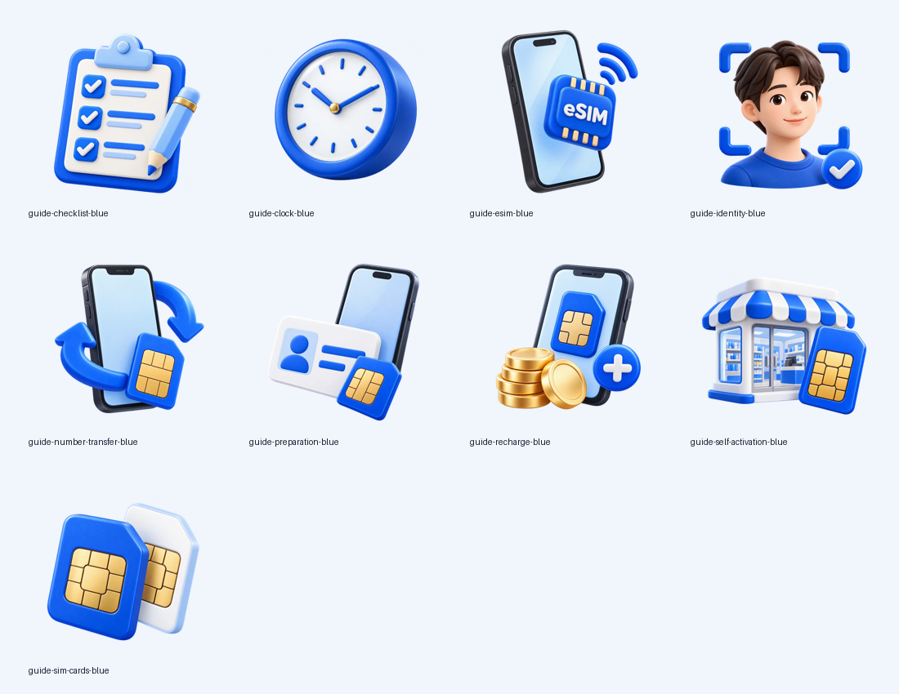
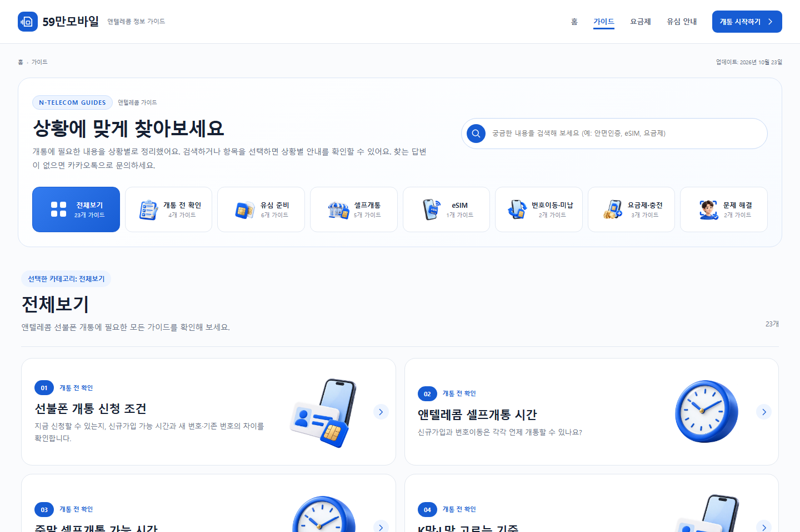

# PR #5 보완: 참고 플러그인 분석과 이미지 직접 제작

작업 브랜치: `design/information-hub-20261025`. 운영 기준은 `727568f`이며 운영 main 병합·배포는 수행하지 않습니다.

## 원본 ZIP에서 확인한 구성

실제 제공된 파일은 `life-guide-visual-editor-v2.6.2.zip`입니다. 파일명에 `(1)`이 붙은 별도 파일은 확인되지 않아 첨부 경로에 있는 이 파일을 분석했습니다.
[분석 기록과 ZIP SHA256](plugin-analysis.json)을 남겼습니다. ZIP의 문서는 실행 지시가 아닌 참고 자료로 사용했습니다.

- `templates/page-guide.php`: 공개·노출 대상 글을 읽고 저장된 순서와 ID로 정렬합니다. 8개 카테고리, 카테고리별 제목·설명·대표 그림, 세부 필터, 번호·분류·제목·요약·태그·오른쪽 그림이 있는 카드를 렌더합니다.
- `assets/guide-hub.css`: PC 8개 카테고리와 2열 가이드 카드, 모바일 3열 카테고리와 마지막 2개 중앙 정렬, 모바일 1열 목록입니다. PC 그림 영역은 약 158×144px, 모바일은 약 94×94px입니다.
- `assets/guide-hub.js`: 모바일 기본 준비 분류, 카테고리 선택 시 목록으로 스크롤, 목록의 카테고리 복귀 버튼, 세부 필터, 검색, 표시 번호 재계산, 브라우저 뒤로가기, 전체보기에서 카테고리 재정렬과 브라우저 저장을 처리합니다. 선택 화면을 제거하는 방식이 아니라 위에 유지합니다.
- `includes/guide-order-admin.php`: 제목·요약·분류·이미지·노출 여부·순서의 기존 데이터를 사용합니다.
- `assets/images/`: 8개 모두 640×640 RGBA WebP입니다. 체크리스트, eSIM, 안면인증, 번호이동, 준비물, 충전, 편의점·유심, 유심 2종입니다.

실제 v2.6.2는 이미 `/guide/` 통합 템플릿을 포함합니다. `life-guide-visual-editor.php`의 895–914행에는 테마보다 먼저 이 템플릿을 선택하는 처리가 있습니다.
README의 v2.5.11 기록에는 이전 QUICK START 구성이 제거됐다고 명시되어 있습니다. 따라서 복사된 예전 설명과 실제 ZIP을 구분했습니다.

59man.shop 저장소는 정적 사이트이므로 PHP 실행 환경을 추가하지 않았습니다. PHP가 만들던 실제 문서 구조를 [build_guide.py](../scripts/build_guide.py)로 이식하고, [전용 CSS](../assets/guide-hub.css)와 [탐색 JS](../assets/guide.js)를 함께 재설계했습니다.
이전 목록·본문 미리보기용 CSS는 공유 스타일에서 제거했습니다. 기존 카테고리명·해시 링크·23개 안내글은 유지하고, 플러그인의 `guide_category` 쿼리도 별칭으로 지원합니다.

## 직접 생성한 이미지

내장 `image_gen`으로 8종을 새로 제작하고, 렌더링 비교 후 시간 안내용 시계 1종을 추가 제작했습니다. 원본 핑크 이미지를 필터로 바꾼 것이 아닙니다.
공통 스타일은 #175CD3 기반 블루·아이스 블루·화이트, 둥근 입체 모서리, 새틴 재질, 같은 광원입니다. 칩과 충전의 금색은 의미를 위한 보조색입니다.

9종 모두 투명 512×512 WebP이며 총 369,482바이트입니다. [생성 프롬프트 전체](../data/illustration-prompts.json), [파일·크기·투명도 검사](illustration-validation.json), [실제 사용 매핑](../scripts/guide_visuals.py)을 보관했습니다.
최종 파일은 모두 [img/guide-art](../img/guide-art/)에 저장했습니다. 검색·메뉴·화살표·전체보기 그리드 등 단순 UI 요소는 SVG입니다.

| 이미지 | 파일 | 적용 용도 |
|---|---|---|
| 안면인증 | [WebP](../img/guide-art/guide-identity-blue.webp) | 문제 해결 카테고리·안내·첫 퀵가이드 |
| 신분증·휴대폰·유심 | [WebP](../img/guide-art/guide-preparation-blue.webp) | 개통 신청 조건·준비물·통신망 선택 |
| 편의점·유심 | [WebP](../img/guide-art/guide-self-activation-blue.webp) | 셀프개통 카테고리·카드 |
| 체크리스트 | [WebP](../img/guide-art/guide-checklist-blue.webp) | 개통 전 확인 카테고리·분류 소개 |
| 번호이동 | [WebP](../img/guide-art/guide-number-transfer-blue.webp) | 번호이동·미납 분류·안내 |
| 요금 충전 | [WebP](../img/guide-art/guide-recharge-blue.webp) | 요금제·충전 분류·안내 |
| eSIM | [WebP](../img/guide-art/guide-esim-blue.webp) | eSIM 분류·안내 |
| 유심 2종 | [WebP](../img/guide-art/guide-sim-cards-blue.webp) | 유심 분류·구매 안내·홈 두 번째 카드 |
| 시계 | [WebP](../img/guide-art/guide-clock-blue.webp) | 평일·주말 개통 시간 카드 |

[원본 8종 비교판](ui/visual-v2/reference-art.png)과 새 9종을 비교했습니다. 투명 영역과 가장자리를 밝은 배경에서 확인했습니다.

실제 유심 제품 사진과 공식 개통 캡처는 변경하지 않았습니다. 기존 가이드 썸네일도 없애지 않고 `/guide/`의 **실제 화면으로 확인하세요** 영역으로 연결했습니다. 홈 카드의 실제 자료 썸네일도 유지했습니다.

## 화면 비교와 수정

| 참고 구성 | 구현·확인 |
|---|---|
| PC 8개 카테고리 | 그림·제목·현재 안내 수, 블루 선택 상태 |
| PC 2열 가이드 카드 | 번호·분류·기존 제목·요약·큰 오른쪽 일러스트·SVG 이동 표시 |
| 모바일 3열 선택 화면 | 3+3+2 중앙 정렬, 그림 56px 영역, 390/430px 캡처 |
| 모바일 목록 화면 | 분류 소개 그림·세부 필터·일러스트 카드·복귀 버튼 |
| 본문 이동 | PC·모바일 모두 기존 상세 URL로 이동, 기존 문서 내용 유지 |
| 퀵가이드 참고 화면 | 홈과 기존 빠른 안내 영역에 3열/모바일 1열, 첫 카드 블루 그라데이션, 다른 일러스트와 안내 보기 버튼 |

첫 렌더링에서 발견한 사항을 수정했습니다.

1. 모바일 목록 위에 이전 화면 여백이 남던 문제: 문서의 스크롤 여백과 섹션 여백이 중복되지 않게 조정했습니다.
2. 두 시간 안내에 체크리스트가 반복되던 문제: 같은 스타일의 시계를 새로 생성해 용도에 맞게 바꿨습니다.
3. 홈의 두 번째·세 번째 이미지가 같던 문제: 유심 2종과 편의점·유심으로 구분했습니다.
4. 실제 자료와 일러스트가 혼동되지 않도록 실제 자료의 별도 썸네일·갤러리를 유지했습니다.

| 실제 캡처 | PC 1440px | 모바일 390px | 모바일 430px |
|---|---|---|---|
| 카테고리 선택 | [보기](ui/visual-v2/guide-chooser-1440.png) | [보기](ui/visual-v2/guide-chooser-390.png) | [보기](ui/visual-v2/guide-chooser-430.png) |
| 카테고리 목록 | [보기](ui/visual-v2/guide-list-1440.png) | [보기](ui/visual-v2/guide-list-390.png) | [보기](ui/visual-v2/guide-list-430.png) |
| eSIM 선택 | [보기](ui/visual-v2/guide-esim-1440.png) | [보기](ui/visual-v2/guide-esim-390.png) | [보기](ui/visual-v2/guide-esim-430.png) |
| 기존 상세 페이지 | [보기](ui/visual-v2/detail-1440.png) | [보기](ui/visual-v2/detail-390.png) | [보기](ui/visual-v2/detail-430.png) |
| 홈 퀵가이드 | [보기](ui/visual-v2/home-quick-1440.png) | [보기](ui/visual-v2/home-quick-390.png) | [보기](ui/visual-v2/home-quick-430.png) |
| 가이드 전체 | [보기](ui/visual-v2/guide-full-1440.png) | [보기](ui/visual-v2/guide-full-390.png) | [보기](ui/visual-v2/guide-full-430.png) |

이전 PR #5의 [PC 화면](ui/visual-v2/pr5-before-1440.png)·[모바일 화면](ui/visual-v2/pr5-before-390.png)과 비교할 수 있습니다.
일반 5개 너비의 홈·가이드·상세·요금제 캡처도 [ui/after](ui/after/)에 갱신했습니다.
전체·부분 캡처에서는 긴 이미지 중간에 고정 바가 찍히지 않도록 하단 고정 바만 숨겼습니다. 위 표의 선택·목록·상세 등 viewport 캡처에는 실제 하단 바가 표시됩니다.

## 검증과 보존

- [전체 화면 검사](browser-verification.json): 실제 화면 46개 × 390/430/480/1024/1440px = 230회. 가로 스크롤·깨진 이미지·글자 겹침·중복 ID·문서 구조 오류 0.
- [최종 홈·가이드 추가 검사](visual-browser-verification.json): 최종 구성과 SVG 컨트롤, 카테고리 선택·세부 필터·복귀·검색·내부 이동·브라우저 저장을 확인합니다.
- [요청 너비별 시각 캡처 결과](ui/visual-v2/results.json): 1440/390/430px의 선택·목록·eSIM·상세·홈 상태별 오류 0.
- [SEO 보존 검사](seo-preservation.json): 기존 HTML 55개의 제목·메타데이터·canonical·JSON-LD·기존 본문 문구·링크·실제 이미지 URL 누락 0. robots.txt·sitemap.xml·CNAME 유지.
- [사이트 검사](site-check.txt): `python scripts/check_site.py --table` 통과. 생성기 재실행 시 HTML 결과 동일.

브라우저 검증은 Chromium 및 모바일 터치 에뮬레이션 기준이며 실제 iOS/Android 단말이나 WordPress PHP 실행 검증은 포함하지 않습니다.
기존 설정상 index 대상 25개 / noindex 30개를 유지했습니다. 실제 색인 완료 수나 검색 노출을 보장하지 않습니다.
